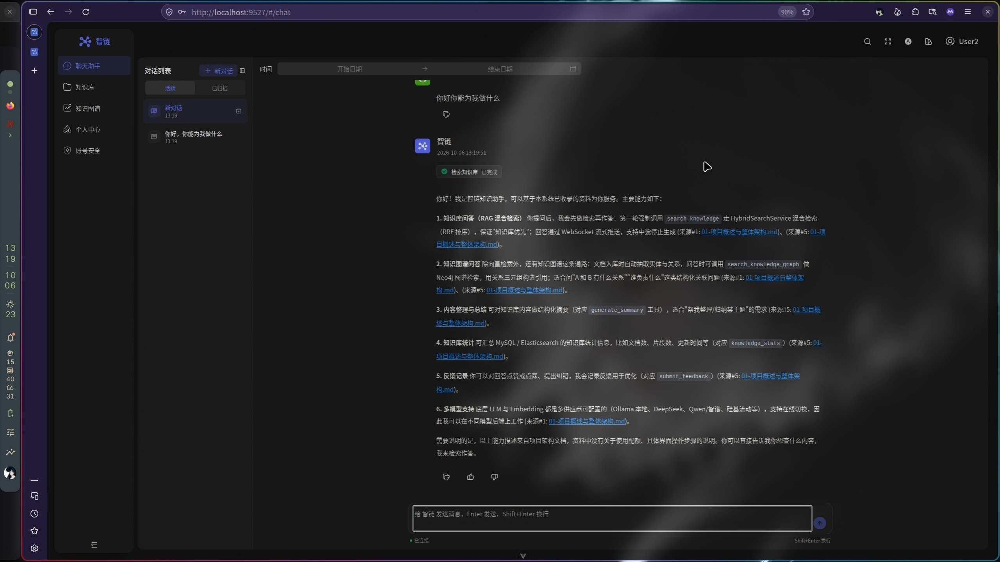
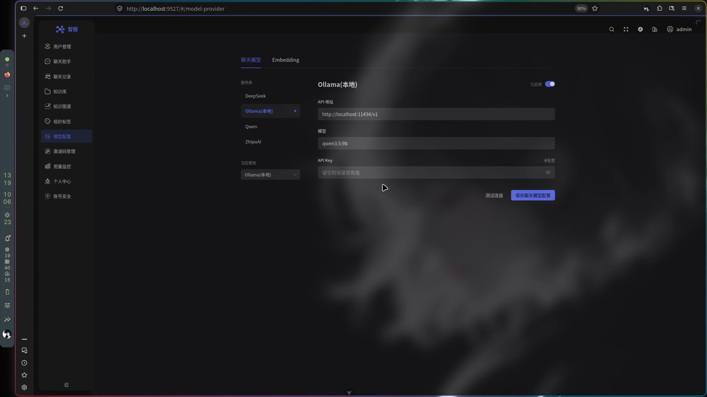
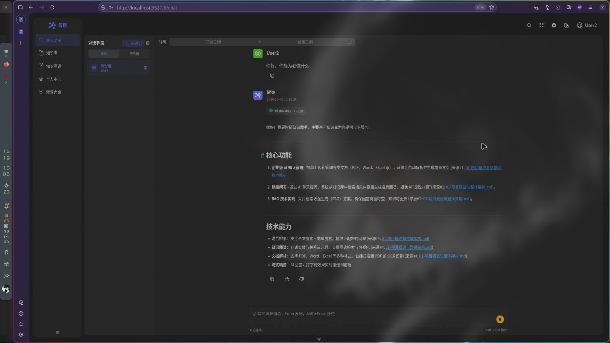
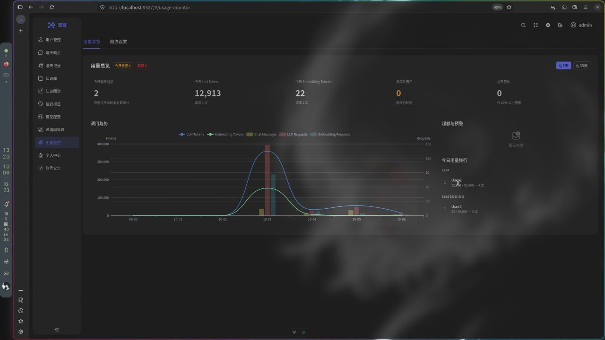

# 智链 ZhiLian · 企业级 RAG AI 知识库

> 基于检索增强生成（RAG）的企业级 AI 知识管理系统：上传企业内部文档，系统自动解析、向量化并建立混合索引；提问时通过「全文检索 + 向量检索」混合召回（RRF 融合排序），由大模型流式生成**带引用溯源**的回答，并配套知识图谱、多组织权限、Token 配额与用量监控等企业级能力。

本仓库为**项目演示仓库**，收录系统实际运行录屏。▶ 点击下方图片即可播放对应视频。

## 🖥️ 界面与功能展示

覆盖聊天助手（流式回答 + 引用溯源）、知识库管理、知识图谱可视化、用户管理（Token 配额）、聊天记录审计等核心页面与功能。

## 🦙 Ollama 本地模型

接入 Ollama 本地推理，数据不出内网，支持在界面中切换本地 / 云端模型。

### 模型切换展示

### Ollama + Qwen 9B 回答展示

基于本地部署的 Qwen 9B 模型进行知识库问答：命中知识库 → 混合召回 → 流式输出，回答附带「来源#N」引用，可点开原文比对。

## 🐬 DeepSeek 模型回答与用量监控

切换 DeepSeek 云端 API 后的问答效果；管理端可实时监控 LLM / Embedding 的 Token 消耗、用量趋势、超额预警与用户用量排行。

## ✨ 核心特性

- **混合检索**：Elasticsearch 全文检索 + 向量检索，RRF 融合排序，回答带「来源#N」引用，点击可查看原文片段
- **流式响应**：WebSocket 推送，打字机效果实时输出，检索过程状态可见（检索知识库 → 已完成）
- **知识图谱**：抽取实体与关系三元组存入 Neo4j，支持图谱检索与可视化浏览
- **文档处理**：Kafka 异步解析与向量化，Apache Tika 支持 PDF / Word / Excel 等多格式，阿里云 OCR 支持扫描版 PDF
- **企业级管理**：多组织 / 组织标签权限，用户 LLM 与 Embedding Token 配额、追加 Token、邀请码管理、聊天记录审计
- **多模型接入**：Ollama 本地模型（Qwen）、DeepSeek 云端 API，WebFlux WebClient 流式调用

## 🧱 技术栈

| 分层 | 技术 |
| --- | --- |
| 后端 | Java 17 · Spring Boot 3.4.2 · Spring Security + JWT · Spring Data JPA · WebFlux |
| 检索 | Elasticsearch 8.10（全文 + 向量混合检索，IK 分词）· HanLP 中文分词 |
| 存储 | MySQL 8.0 · Redis · MinIO（对象存储）· Neo4j 5（知识图谱） |
| 中间件 | Kafka（异步文档解析与向量化）· WebSocket（流式推送） |
| AI | Ollama（本地 Qwen）· DeepSeek API · 阿里云 OCR |
